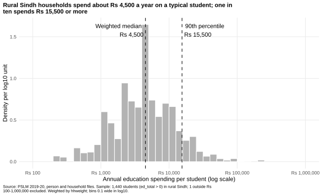
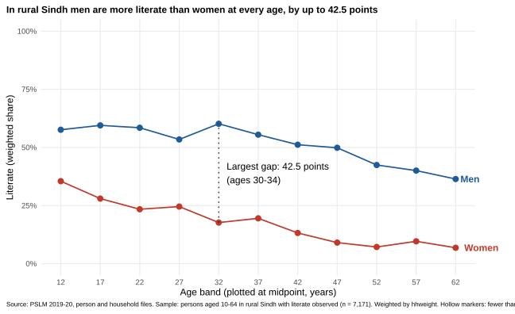
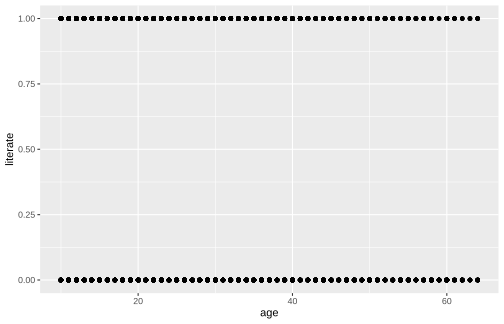

# ECO346-A1-FA24-BED-098

**Name:Zunaira Zahid**
**Registration no.:** FA24-BED-098 | **Section:** B
**Variant:** 98 = 12 × 8 + 2, so **variant 2: Sindh, rural** (prov_code 3, urban_rural 1).

Data: PSLM 2019–20 person and household files (`data/`). Everything is weighted by `hhweight`.
To reproduce: run `scripts/01_default.R`, `02_distribution.R`, `03_literacy.R` (R) and `04_second_language.py` (Python) from the repository root.

## Question 2: The distribution

| Statistic | Value |
|---|---|
| Students (ed_total > 0) | 1,440 |
| Weighted median | Rs 4,500 |
| Unweighted median | Rs 4,295 |
| Weighted 10th percentile | Rs 1,000 |
| Weighted 90th percentile | Rs 15,500 |
| Ratio p90 / p10 | 15.50 |
| Excluded (outside Rs 100–1,000,000) | 1 |

**What the figure shows:** Spending per student in rural Sindh is strongly right-skewed: most students cost households a few thousand rupees a year, while a long tail reaches Rs 250,000. The 90th percentile (Rs 15,500) is 15.5 times the 10th (Rs 1,000). The weighted median (Rs 4,500) is slightly above the unweighted one (Rs 4,295) because sampled households represent different numbers of households in the population, so weighting shifts the centre up a little. The difference is small.

## Question 3: The relationship

Sample: persons aged 10–64 in rural Sindh with literate observed (n = 7,171). No band has fewer than 30 observations, so no marker is hollow.

| Band | Men n | Men literate % | Women n | Women literate % |
|---|---|---|---|---|
| 10-14 | 718 | 57.6 | 529 | 35.5 |
| 15-19 | 548 | 59.5 | 446 | 28.0 |
| 20-24 | 422 | 58.5 | 455 | 23.4 |
| 25-29 | 419 | 53.4 | 430 | 24.6 |
| 30-34 | 382 | 60.2 | 399 | 17.7 |
| 35-39 | 391 | 55.5 | 319 | 19.5 |
| 40-44 | 274 | 51.2 | 285 | 13.2 |
| 45-49 | 221 | 49.9 | 198 | 9.1 |
| 50-54 | 208 | 42.4 | 152 | 7.2 |
| 55-59 | 100 | 40.0 | 98 | 9.6 |
| 60-64 | 100 | 36.4 | 77 | 6.8 |

- Ages 15–19: women 28.0%, men 59.5%.
- Ages 55–59: women 9.6%, men 40.0%.
- Largest gap: **30–34** (42.5 percentage points).

**Interpretation:** In rural Sindh men are more literate than women in every age band. Men's literacy stays around 50–60% until their 40s and then falls to 36% at 60–64; women's falls from 36% at 10–14 to 7% at 60–64. The largest gap, 42.5 points, is at ages 30–34. Younger women have had more schooling than older ones, which is consistent with expanding access to education. The figure cannot tell us whether this is a cohort effect or an age effect, because it is one cross-section.

## Question 4: The makeover

Default (R defaults, `geom_point()` only): `figures/default.svg`

The redesign is the Question 3 figure above.

**Explanation:** The default plots 7,171 persons as points at 0 or 1, so they pile up (overplotting) and show no pattern, and it ignores the weights. First, I replaced the points with weighted literacy rates by five-year age band, that is, conditional means, which reveal the trend. Second, I encoded the rate by position on a common scale, the most accurately read channel, and separated women and men with colour and joined lines; direct end labels replace a legend, cutting data-ink and look-up effort. Third, I added a 0–100% axis, a finding as the title, an annotation of the largest gap (30–34, 42.5 points) and hollow markers for thin cells. What the default shows and the redesign hides is the individual observations: single-year ages, the number of people behind each point, and the variation within each band.

## Question 5: Second language (Python)

Script: `scripts/04_second_language.py`. Figure: `figures/literacy_by_age_python.svg`.

- Women aged 15–19: **28.0%** in R and **28.0%** in Python.
- The R and Python band tables agree to one decimal place.

**Default that differed:** Axis padding differed: ggplot2 expands each axis by 5% by default, while matplotlib uses its own margins, so the two figures initially had different frames. In Python I set the limits (0–100%), the x-ticks at the band midpoints 12, 17, …, 62 and the right margin for the end labels explicitly. For the band table I also fixed left-closed five-year bands and the same `hhweight` weights in both languages.
